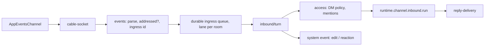

# Sabha channel architecture

Target: OpenClaw **2026.11.1**, Node **24.16+**. External channel plugin, id
`sabha`, npm `@sabha-co/openclaw-sabha`. No server process of its own: it opens
an outbound WebSocket per account and calls the Sabha REST API.

## Entries and loading

`index.ts` (`defineChannelPluginEntry`) registers:

- the channel plugin (`src/plugin/channel.ts`, built with `createChatChannelPlugin`
  on the gateway v2 adapter)
- the CLI in `registerCliMetadata`, with static descriptors; `src/cli.ts` loads
  only when `openclaw sabha …` runs
- two tool factories in `registerFull` (tool context v2)

`setup-entry.ts` (`defineSetupPluginEntry`) loads only config, setup and status
(`src/plugin/channel.setup.ts`). The monitor, socket, drafts and REST client
are not in that graph. The full plugin also keeps them behind lazy imports:
`channel.runtime.ts` for the monitor and sends, and `import()` inside action,
directory and resolver handlers. Discovery never constructs a client.

`scripts/generate-manifest.mjs` projects `src/config/schema.ts`,
`src/config/setup-contract.ts` and `src/plugin/meta.ts` into
`openclaw.plugin.json` and `package.json#openclaw.channel`.

## Accounts

`src/config/accounts.ts` merges channel-root settings with
`channels.sabha.accounts.<id>`. The account's own values win. Credentials
(`appKey`, `cableUrl`, `name`) are read from the account only. From `url` it
derives:

- `apiBaseUrl` = `url + /api/v1` (on sabha.co the workspace number is in the path)
- `cableUrl` = `wss://host/cable`, plus `?wid=<workspace>` on sabha.co (the
  cable is never under the workspace path)

## Inbound

**Connection** (`src/monitor/cable-socket.ts`). One `actioncable-v1-ext-json`
connection with `Authorization: Bearer <appKey>`: welcome, subscribe, confirm.
Each event frame carries `stream_id/epoch/offset`. The monitor keeps the last
position per stream and sends a `history` request after every subscribe. The
first connection asks for nothing; a reconnect asks from the known positions,
or from 5 s before the last ready time. Server pings arrive every 3 s, so 10 s
of silence drops the connection. A handshake `401/403`, a rejected subscription,
or `disconnect` with `reconnect: false` is terminal.

**Account lifecycle** (`src/monitor/monitor.ts`). `/me` gives the app's own id,
retried with backoff. `401/403` parks the account as `blocked` until abort.
Then it connects, marks the account `ready` once subscribed, and on close waits
`computeBackoff` (1 s to 60 s, ×2, 20% jitter) through the host scheduler.
Abort leaves the account `stopped`. Each event also feeds the mention
rewriter's name cache. Admissions are chained so events reach the queue in
arrival order.

**Addressing and ids** (`src/monitor/events.ts`). Self echoes, deletes,
`user_*` events and unaddressed top-level room messages are dropped before the
queue. DMs and threads are always addressed. Ingress ids are `message:<id>`,
`edit:<id>:<updated_at>`, `react:` / `unreact:` + reaction id. The lane is
`room:<id>`, so one room is processed in order and rooms run in parallel. A
replayed event with a known id is not handled twice.

**Turn** (`src/inbound/turn.ts`). Resolves the agent route and the session
(`src/session.ts`):

- Group peer is `<accountId>:<roomId>`. A thread is its own room, so a thread
  has its own session.
- DMs use `per-account-channel-peer`.

Access (`src/inbound/access.ts`) goes through `inbound.ingress.resolveStable`
with a verified `sabha-user-id` identity. `dmPolicy: open` maps to `["*"]`.
There is no pairing store.

A new message becomes a host turn through `runtime.channel.inbound.run`. Its
`resolveTurn` downloads any attachment through `saveRemoteMedia` (guarded by
`ssrfPolicyFromAllowPrivateNetwork`), builds the envelope and context with
`inbound.buildContext`, and wires delivery. Edits and reactions are passed to
`runtime.system.enqueueSystemEvent` on the conversation's session after the
same access check.

## Outbound

**Where a reply goes** (`turn.ts` `replyTargetFor`). A top-level group message
gets its reply threaded under it (`parent_message_id`) unless `replyToMode` is
`off`. Sabha creates or finds the thread room and returns its id. In threads
and DMs the reply goes to the same room.

**Text** (`src/outbound/send.ts`, `src/client/rich-text.ts`). Markdown is
chunked (`chunkMarkdownTextWithMode`, 12,000 chars by default) and each chunk
is rendered once to the HTML Lexxy exports:

- paragraphs and ` `
- `<pre data-language>`
- tables and `<s>`
- images as links
- raw HTML escaped

`@{id}` tokens pass through for the server to turn into mentions. The mention
rewriter maps names the agent wrote as `@Name` to `@{id}` when the cache knows
them.

**Media**. Remote URLs go through `readRemoteMediaBuffer`. Local paths go
through `resolveOutboundAttachmentFromUrl` with the turn's `mediaAccess`.
Files are capped at 50 MB and sent as a multipart `attachment`.

**Live drafts** (`draft-transport.ts`, `reply-delivery.ts`). On by default
(`livePreview`). They use the `AppEventsChannel#draft` action and
`client_message_id`; a server without the action ignores the frames, and the
final posts as usual. When on:

- `onPartialReply` sends `draft start/text` frames, throttled to 250 ms.
- The final is posted with `client_message_id = draft_id` so it replaces the
  draft in place. If that post fails, the reply is posted normally. If a later
  chunk fails after the first landed, the lifecycle keeps what landed and does
  not repost.
- `finish()` always ends a draft the final did not replace.
- Turns deferred to an active run (`followup`) skip cleanup.
- Draft text goes out before the final's modifying hooks run, and an external
  plugin cannot see whether such hooks exist. Operators with redacting hooks
  set `livePreview: false`.

**The `message` tool** (`src/actions/`). Discovery is static. Handlers run
lazily on the turn's account. Targets (`src/outbound/target.ts`,
`src/plugin/messaging.ts`):

| Input | Resolves to |
|---|---|
| `21`, `channel:21`, `room:21`, `group:21` | room |
| `user:5`, `@{5}` | DM room via `POST /direct_messages` |
| `#name`, `@name` | the directory resolver |

A `threadId` (a thread room) beats the target, and `replyToId` becomes
`parent_message_id`. Writes revalidate host authority first.

**Directory** (`src/directory.ts`):

- Rooms come from `GET /rooms`.
- People come from `GET /users`, skipping other apps, 100 per page, up to 50
  pages. Live search uses `/autocompletable/users`.
- Name resolution prefers an exact name and reports ambiguity in a note.

**Threading context** (`messaging.ts` `buildSabhaThreadingToolContext`).
Top-level group turns pass the account's `replyToMode`, so the first
message-tool send threads under the inbound message. In threads and DMs it is
`off`.

## Status

Status goes through the v2 `setStatus` sink:

- `channelReadyPatch` once subscribed
- `channelBlockedPatch(reason)` for terminal auth failures
- `channelStoppedPatch` on abort

## Tests

- Unit tests sit next to each module.
- `src/sdk-imports.test.ts` guards SDK subpaths.
- `scripts/host-integration.mjs` (via `npm run test:pack`) installs the packed
  tarball into a disposable host and drives it with a fake Sabha REST + cable
  server. It covers three modes:
  - **stream:** live draft, final replaces the draft, replay dedup, react
    through the host message runner, fatal disconnect
  - **rewrite:** a `message_sending` rewrite hook
  - **cancel:** a cancel hook

  The only substitution is the reply producer.
